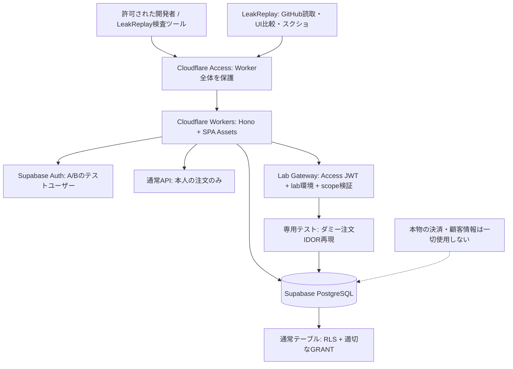
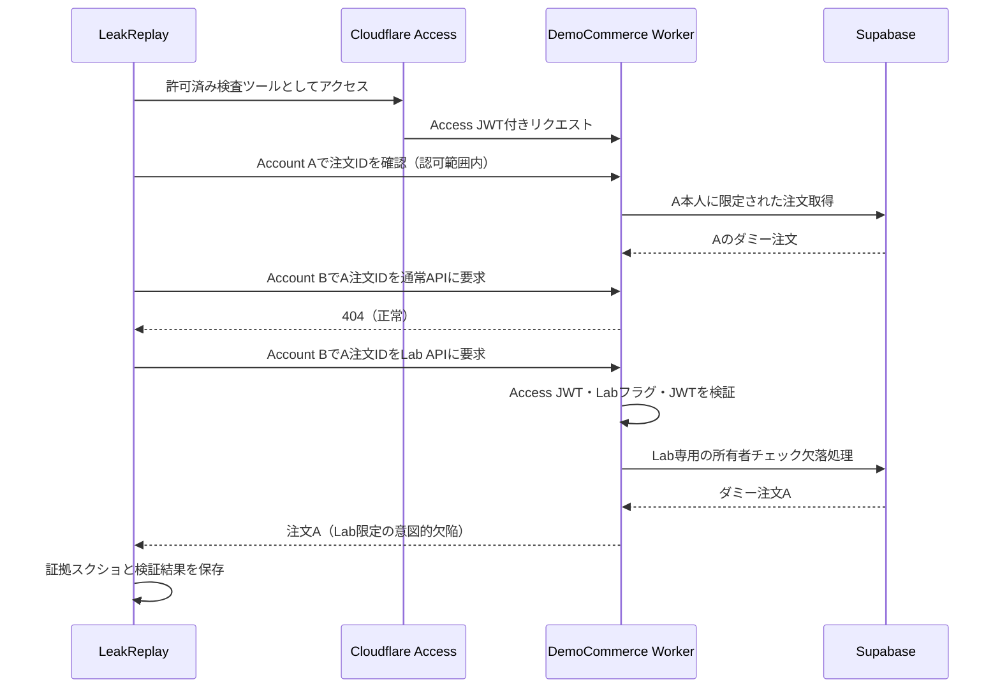

# DemoCommerce — Codex実装要件定義書

> Version: 1.0 / 2026-10-18  
> Status: MVP specification / Implementation target: **Cloudflare Workers + Supabase**  
> このリポジトリは **LeakReplay（診断側）とは別リポジトリ**。本書はCodexに渡す実装仕様であり、診断サイトをインターネット上に無防備に公開することは許可しない。

## 0. Codexへの最優先指示

1. 本書、`AGENTS.md`、`CODEX_START.md`、`TEST_MATRIX.md` を読み、既存コードを検査してから実装する。既存実装は可能な限り尊重する。
2. **初回の実装範囲はM0 + M1まで。** それ以上は承認されるまで着手しない。未入手のCloudflare/Supabase資格情報は仮定せず、`.example`とMockで動く形にする。
3. 人間の個人情報、実在店舗、実際の決済、外部への攻撃通信は扱わない。固定の架空商品・架空ユーザー・架空注文のみ。
4. セキュリティ欠陥は**Cloudflare Accessで保護された専用のlab環境のみ**に隔離する。通常の注文APIやSupabase RLSに意図的な穴を開けない。
5. すべてのリクエスト・リダイレクト・レスポンスについて認証・認可・機密値を扱う箇所を確認する。Lab機能は `APP_ENV=lab` かつ `LAB_ENABLED=true` かつCloudflare Access検証成功時だけ稼働。それ以外は404（fail closed）。
6. 実装後は `lint / typecheck / unit / DB RLS test / E2E / build` の成功・失敗・未実施をそれぞれ報告する。Cloudflareデプロイは外部ID・資格情報が揃ってから明示的な承認を経て行う。

## 1. 目的とスコープ

**目的**：LeakReplayがGitHubリポジトリと許可済みWebアプリを検査し、アクセス制御不備（IDOR/BOLA）を実測で検知して、スクリーンショット付きレポートを生成できるか検証するための**見た目と動作が自然なテスト用通販サイト**を用意する。

**対象**：PC/モバイルブラウザ、商品一覧、商品詳細、カート、擬似注文、ログイン、マイページ、注文履歴、注文詳細。データはSupabase PostgreSQL。UI/APIはCloudflare Workers。

**非対象（MVP）**：本物の決済、配送、メルマガ送信、在庫引当、管理者向け商用EC機能、実画像アップロード、実ユーザーデータ、ソーシャルログイン、多言語、クーポン、商品レビュー、メール配信、実地攻撃スキャン、公開向け脆弱性チャレンジサイト。

**MVPで確実に検証するケース**：
- **LAB-IDOR-001（脆弱）**：テストアカウントBでログインし、専用Lab画面からAのダミー注文IDを開くとAのダミー注文が見える（意図的なアプリケーション側の認可不備）。
- **CONTROL-IDOR-001（正常）**：通常の注文詳細画面で同じ操作をすると404になる。
- **CONTROL-ANON-001（正常）**：ログインせず注文詳細APIを呼ぶと401になる。

Labシナリオは**独立の専用コード領域と追加ガード**の内部だけに実装する。脆弱性を実在ユーザーのデータで再現しない。

## 2. 推奨技術・責務

| レイヤー | MVP採用技術 | 用途 |
|---|---|---|
| UI | React + TypeScript + Vite | 商品一覧・カート・ログイン・注文履歴・Lab証拠画面 |
| API | Hono + Cloudflare Workers + Workers Static Assets | `/api/*`とSPAを1 Workerで配信 |
| DB | Supabase PostgreSQL | 商品・プロフィール・注文・明細・カート |
| 認証 | Supabase Auth (email/password) | A/BのログインとJWT発行 |
| DB認可 | Postgres RLS +明示的なGRANT/REVOKE | 通常ユーザーの所有データへのアクセス制御 |
| Labの追加防御 | Cloudflare Access（Worker単位）+ Worker内のAccess JWT検証 | 限定された人/診断ツールしか到達できないようにする |
| Lab固定データ | Supabase CLI migrations / seed / テストユーザー作成スクリプト | リセット可能な架空データ |
| E2E | Playwright | A/Bの動作、スクショ、失敗ケース検証 |
| DB検査 | Supabase CLI + pgTAP | RLSのallow/denyの検証 |
| 品質 | Vitest / ESLint / TypeScript | 再現可能なテスト |

Supabase以外のDB（Cloudflare D1など）を追加しない。Workersでサーバーサイド実行するため、Node専用APIに依存しない。

## 3. システム構成図



**重要**：Lab APIは意図的にユーザーごとの所有者確認が不足する例を作るが、Cloudflare Accessで**アプリ全体へのアクセス**を制限し、Worker側でもJWTとLab環境を検証する。Supabaseの一般向けテーブル権限・RLSは常に有効。Labシナリオで実際に読めるのは、専用Supabaseプロジェクトに投入された架空のテスト注文だけ。

## 4. ディレクトリ構成（Codexが生成）

```text
/
  AGENTS.md
  CODEX_START.md
  SPEC.md
  TEST_MATRIX.md
  DEPLOY_CLOUDFLARE_SUPABASE.md
  README.md
  package.json
  wrangler.jsonc
  vite.config.ts
  .dev.vars.example
  .env.example
  .gitignore
  src/
    react-app/
      App.tsx
      pages/{Home,Product,Cart,Login,Account,Orders,OrderDetail,LabOrderDetail}.tsx
      components/{ProductCard,NavBar,Notice}.tsx
      lib/{api,auth,cart}.ts
    worker/
      index.ts
      middleware/{requireUser,requireAccess,requireLab}.ts
      routes/{products,cart,checkout,orders,lab}.ts
      services/{supabase,orders,labFixtures}.ts
    shared/{schemas,types}.ts
  supabase/
    config.toml
    migrations/<timestamp>_initial.sql
    seed.sql
    tests/orders_rls.test.sql
  scripts/
    provision-test-users.ts
    reset-test-fixtures.ts
    assert-lab-isolated.ts
  tests/
    unit/
    e2e/{shop,security-idors}.spec.ts
  integrations/
    leakreplay-fixtures.json
```

`src/react-app/pages/...`等は設計上の目安。Cloudflare公式テンプレートが異なる場合は自然な構造に調整し、機能とテスト契約は守る。

## 5. UIと利用フロー

### 5.1 全画面（必要なものだけ）

| route | UI | 動作 |
|---|---|---|
| `/` | トップ・商品一覧 | 商品カードを表示、8〜12件の架空商品。検索/カテゴリは任意 |
| `/products/:slug` | 商品詳細 | 価格、説明、在庫表示、カートに追加 |
| `/cart` | カート | 個数変更、削除、価格合計、注文へ進む |
| `/login` | ログイン | Supabase AuthでA/Bテストユーザー認証、エラー処理 |
| `/account` | マイページ | テスト用ユーザー名、注文履歴へのリンク |
| `/orders` | 注文履歴 | ログイン本人の注文一覧のみ |
| `/orders/:id` | 注文詳細（正常） | 注文本人のみ表示、他ユーザーIDは404 |
| `/lab/orders/:id` | Lab専用の注文詳細 | Labモードのみ。脆弱性の証拠を確認できるよう、注文情報と明示的な`DEMO / SYNTHETIC DATA`バナーを表示 |
| `/*` | 404 | 未定義URLは安全に処理 |

デザイン：実在ブランド風ではなく「DemoCommerce（架空ストア）」としてUIを統一。カード、商品画像はローカルSVG/CSSプレースホルダーでよい。レスポンシブ、loading/empty/error、キーボード操作、スクショ取得時にレイアウトが安定する固定画面幅をサポート。

### 5.2 購入フロー

1. 商品一覧で架空商品を選択する。
2. カートに追加し個数変更する（MVPではカートはLocalStorageでもよい）。
3. サインインしていなければログインする。
4. 「テスト注文を確定」を押すと、**実際の課金なく**DBに注文と明細を保存する。画面には「決済は発生しません」と常時表示。
5. `/orders`から自分の注文を閲覧できる。DBの価格・商品情報をサーバー側で再取得し、フロントからの価格を信用しない。注文・明細の書き込みはDBトランザクションで原子化。

## 6. Supabase DB設計

### 6.1 テーブル

| テーブル | 必須カラム | 操作・制約 |
|---|---|---|
| `products` | `id uuid PK, slug unique, name, description, price_jpy int, category, image_path, is_active bool, stock int` | 架空商品8〜12件、価格は非負、匿名読み取り可 |
| `profiles` | `id uuid PK references auth.users, display_name, created_at` | 本人のみselect/update、メールや住所を保存しない |
| `orders` | `id uuid PK, user_id uuid references auth.users, order_code unique, status, total_jpy int, created_at` | 本人のみselect。Labも同じ架空注文データのみ使用 |
| `order_items` | `id uuid PK, order_id uuid references orders, product_id uuid references products, quantity int, unit_price_jpy int` | 親注文の所有者のみselect |

MVPでカートをLocalStorageに置く場合`cart_items`テーブルは作らない。金額は整数JPY、数量は1〜10、注文合計をサーバー側で計算。商品削除は論理削除 (`is_active`) のみ。

### 6.2 DB安全要件

- 全アプリ用テーブルでRLSを有効にする。anonymous/authenticated/service_roleのGRANTを明示し、必要最小限に制限。
- `orders.user_id`の一致を基準に通常の注文取得を制限。アプリAPIでも本人確認を実施。**クライアントが送った`user_id`で所有権を決めない**。
- `order_items`は`orders`所有者に連動したRLSを適用。本人以外はDB API経由でも取得不可。
- 注文確定はサーバーで認証済みJWTを検証し、DB上の商品価格と数量制約を確認するトランザクションで行う。SQL/RPCはPostgresの権限設定と所有者検査をレビューしたうえで作成。
- Supabase Secret key（旧service_role key含む）はWorkerのsecret以外に置かず、ブラウザ/HTML/ログ/CI公開ログに絶対に出さない。
- `anon`/`authenticated`からの`service_role`アクセス不可。メール送信、実住所/カード番号の収集はしない。

### 6.3 テストアカウント・初期データ

- Account A（buyer-a@example.test） / Account B（buyer-b@example.test）。いずれも実在ユーザーではなく、Supabase Auth Admin API経由でLab専用Supabaseプロジェクトに作成。
- アカウントごとに2〜3件のダミー注文。安定した識別子（`order_code`など）を使用。Aの注文には`DEMO_ONLY_ORDER_A`の固定目印を含める。
- 商品8〜12件（文房具、雑貨、ガジェットなど）と各種画像プレースホルダー。
- テストユーザーパスワードはプロビジョン時に安全に生成。`seed.sql`、Git、スクショ、Markdownには格納しない。テスト実行時は環境変数/Secrets経由。
- `supabase/seed.sql`では商品などの機密を含まないデータを投入。Authに紐づく注文作成は別のセットアップスクリプトで行い、ローカルリセット後に再実行できるようにする。

## 7. HTTP API契約

| method | path | 認証 | 正常応答 / 要件 |
|---|---|---|---|
| GET | `/api/health` | Access（Labデプロイ） | `200 {ok:true,environment:"lab"}`、秘密情報なし |
| GET | `/api/products` | Access | `200 {items:[...]}`、公開可能な商品情報のみ |
| GET | `/api/products/:slug` | Access | `200 {item}` or 404 |
| GET | `/api/me` | Access + Supabase Auth | `200 {id,displayName}` |
| GET | `/api/orders` | Access + Supabase Auth | 本人の注文のみ |
| GET | `/api/orders/:id` | Access + Supabase Auth | 本人の注文なら200、他人や不存在は404 |
| POST | `/api/checkout` | Access + Supabase Auth | `{items:[{productId,quantity}]}`→201 `{orderId}`、価格はサーバー計算 |
| GET | `/api/lab/orders/:id` | **Access JWT検証 + Supabase Auth + Lab環境** | LAB-IDOR-001のみに利用。架空注文の他人閲覧を再現（所有者チェック不備）。環境条件不成立なら404 |

APIの共通仕様：`application/json`、UTC ISO日時、Zodによる入力検証、無効入力400、未ログイン401、権限不足403/404、内部エラー500は詳細非公開。Error bodyは`{error:{code,message}}`。`orderId`はuuid形式のみ。注文作成にはOrigin/CSRF対策（認証方式に応じて厳格に）、件数上限、IP/ユーザーのレート制限、冪等性を導入。

**Supabase Authの実装**：フロントからのSupabase Authログインを利用してよい。WorkerではユーザーのJWTをサーバー側で検証 (`auth.getUser(token)` 等の認証済み結果を利用)。単なるJWTデコードで認可しない。Lab認証はCloudflare AccessとSupabase Authの両方を必須とする。

## 8. Labの脆弱性シナリオ（隔離・再現性が最優先）

### LAB-IDOR-001：意図的に脆弱な注文詳細

- **目的**：LeakReplayがBログイン状態でAの注文を閲覧できることを検出し、画面証拠で確定できるか検証。
- **入口**：`GET /api/lab/orders/:id` と `/lab/orders/:id`（UI表示）。
- **期待される実装欠陥**：Lab専用の注文取得サービスが**注文IDは検証するが、本人の所有物かは検査しない**。Supabaseのsecret-keyを利用するWorker専用コード（RLSをバイパス可能）だけに設ける。通常のOrders APIやRLSは決して弱めない。
- **防御境界**：専用Labデプロイ、Cloudflare Access Worker全体保護、WorkerでAccess JWT検証、`APP_ENV=lab`、`LAB_ENABLED=true`、A/Bの検証用アカウントのみ、全データが合成データ、診断ツールで許可された既知の注文IDのみ、安全なGETだけ。
- **証拠**：Bとしてサインインし、Aの`orderId`でLab UIを表示すると`DEMO_ONLY_ORDER_A`が画面に現れる。証拠画像に使用するラベルは架空・固定。ログにBearer tokenやCookieを記録しない。
- **検出結果期待**：`confirmed`。通常APIでは同じA注文が404となる比較を必須とする。
- **Lab外の動作**：API・SPAとも404。設定値を変えるだけでprodへ簡単に有効化できないよう、ビルド/デプロイ検証でもLab機能の存在を検査。

### CONTROL-IDOR-001：正常な認可

- Bが通常の`GET /api/orders/:id`でAの注文を要求→404。
- BのSupabase JWTで、Aの注文をSupabase PostgRESTから直接取得しようとしてもRLSで取得不可（空配列/拒否）。
- Aが自身の注文を取得→200。結果をLeakReplayの正常判定検証に使用。

### CONTROL-ANON-001：未認証

- 未ログインで注文詳細API→401。
- Lab APIもSupabase Authがなければ401（Access通過済のセッションを想定）。AccessそのものがないリクエストはCloudflare側で拒否し、Workerに届かない構成。

### 今回作らないシナリオ

SQLインジェクション、任意のリモートコード実行、ログイン総当たり、実秘密キーの流出、実決済改ざん、公開Web全体の巡回/攻撃、意図的なRLS全解除、無認証の実個人情報閲覧は実装しない。

## 9. 安全・運用要件（デプロイ前の必須ゲート）

1. **Lab Worker全体**をCloudflare Accessで保護する。hostname限定の保護だけに依存しない。Worker `workers.dev`/Preview/Custom Domainのアクセス経路を漏らさない。
2. Worker内で`Cf-Access-Jwt-Assertion`の署名・issuer・audience・有効期限を検証。`ACCESS_TEAM_DOMAIN` / `ACCESS_AUD`が未設定または不正ならLab処理は拒否。IP/User-Agent/ヘッダー名だけを信頼しない。
3. Worker内のLabが非`lab`環境で有効化された場合は起動・デプロイ前検証を失敗させる。`LAB_ENABLED`はサーバー側Bindingsのみに設定。
4. Lab用Supabaseプロジェクトは商用/実データプロジェクトと完全分離。常にダミーデータ。Labプロジェクトの鍵は他用途で使い回さない。
5. 実用の通常注文APIはセキュアに実装。Lab脆弱性コードから通常サービスへの権限委譲を許さない。
6. Lab対象は低リクエスト数でテストし、過負荷や大量取得を禁止。レスポンスにCache-Control: no-store。テスト識別子は画面表示可、秘密値/認証トークンは非表示。
7. アカウントのパスワード、Supabase Secret key、Cloudflare Access Service Tokenはアプリ画面、GitHub、LLMへのプロンプト、スクショ、ログに残さない。認証情報はLeakReplay側のTool Gatewayが管理。
8. API全体でレート制限、セキュリティヘッダー、CSP、HTTPS、CORS origin固定、CSRF・セッション管理を適用。
9. すべてのエラー・未確認結果は「安全」とは報告しない。Labが想定通り再現できないときはテスト失敗にする。
10. Cloudflare Accessを設定できない場合、**Labを公開デプロイしない**。ローカルのみで動作させる。

## 10. LeakReplayとの統合契約

- LeakReplayはこの通販サイトの**別リポジトリ**と、認証済みLab用URLを与えられる。GitHubの認可はLeakReplay側で行う。
- テストアカウントA/Bはユーザーの代わりに提供される資格情報として秘密管理し、Agents APIへのメッセージや静的レポートに送信しない。
- 診断対象は`/api/orders/:id`、`/api/lab/orders/:id`、`/orders/:id`、`/lab/orders/:id`のGETのみ（ログインに必要な認証処理は別途許可）。Agentに任意URL / SQL / Shellを渡さない。
- 診断側には、許可済み `test_case_id` からのみ操作できる関数ツールを使わせる。Lab注文の取得は必ず最大1件ずつ、レスポンスサイズ制限。
- `integrations/leakreplay-fixtures.json`に`case_id`、URLパターン、期待結果、必要ロール、証拠要件を定義。実URL・キー・パスワードは含めない。
- 再現テストではGitコミットSHA、環境名、テストケースID、注文識別子、期待と観測、スクショを関連付ける。エージェントが発見したという文章だけで検出成功扱いしない。
- マスク済みスクショに架空タグ`DEMO_ONLY_ORDER_A`が見えること、正常APIでは見えないことを独立テストで評価する。



## 11. 開発マイルストーンと終了条件

| マイルストーン | 実装対象 | Done条件 |
|---|---|---|
| **M0** | Cloudflare React/Vite/Hono雛形、共通レイアウト、商品ダミー表示、環境変数・Mock API | `npm run dev`でトップ/商品画面が表示、lint/typecheck/build成功 |
| **M1** | Supabase CLI、マイグレーション、RLS、Auth画面、商品一覧/詳細、A/Bテストセットアップ | DBリセット後の商品/ユーザー/本人限定注文が検証可能、RLSテスト成功 |
| M2 | カート、擬似チェックアウト、通常の注文履歴/詳細、APIテスト | Aの注文をBが取得できず、本人購入履歴のみ表示 |
| M3 | Lab専用IDORエンドポイントと画面、2層ガード、フィクスチャ定義 | Labにだけ1ケース再現、prod/未許可は404、Access不在は拒否 |
| M4 | Playwright A/B E2E・証拠スクショ、リセット・契約テスト | LAB-IDOR-001成功 / 正常ケースすべて拒否 / 再実行可能 |
| M5 | Cloudflare・Supabaseの限定LabデプロイとLeakReplay接続 | チェックリストと実際の外部疎通テスト、無許可アクセス拒否 |

**初回Codex指示**：M0+M1に限る。デプロイ、意図的なLab脆弱性実装、M2以降の作業は自動で進めない。

## 12. 実装検証・合格基準（要点）

- [ ] React/Vite/Honoの1 Worker構成で動く。`npm run dev`が成功。
- [ ] `supabase db reset`後、マイグレーション・seed・テスト用アカウント作成スクリプトを実行可能。
- [ ] SupabaseのGRANT/RLSテストに合格。Bが通常APIとDB APIでA注文を読めない。
- [ ] A/Bでログイン、商品閲覧、カート、擬似注文、本人注文詳細を操作可能。
- [ ] Lab専用のA→B IDORは確定的に再現でき、別スクショで通常APIの正常拒否も保存できる。
- [ ] 未ログイン401、環境がlab以外404、Access認可のない利用者はCloudflare側で拒否。
- [ ] `.dev.vars`/秘密値がGitに存在しない。Labが未承認の環境では起動/デプロイ不可。
- [ ] Agent/スキャナが利用するテスト用URLとpath/methodの範囲が確定している。
- [ ] テストを2回実行して、`confirmed=1 / normal unauthorized-access finding=0`相当の期待結果が再現可能。

詳細なケース別手順は`TEST_MATRIX.md`、デプロイ要件は`DEPLOY_CLOUDFLARE_SUPABASE.md`。

## 13. Codexが最終報告する項目

- 実装したMilestoneと変更したファイル、主要ルートとAPI
- Supabaseテーブル・migration・RLSポリシーとテスト結果
- `npm run lint` / `npm run typecheck` / `npm test` / `npm run build` / DB tests / E2Eの結果
- 外部ID未入力・Access未設定などで実施できなかった項目
- 手動作業が必要なCloudflare Access / Supabase設定
- 実装した機能に対する残存リスクと次のMilestone

## 14. 公式参照ドキュメント

- Cloudflare Hono + Vite React: https://developers.cloudflare.com/workers/framework-guides/web-apps/more-web-frameworks/hono/
- Cloudflare Access Workers保護: https://developers.cloudflare.com/workers/configuration/cloudflare-access/
- Cloudflare Access JWT検証: https://developers.cloudflare.com/cloudflare-one/access-controls/applications/http-apps/authorization-cookie/validating-json/
- Cloudflare Workers Secrets: https://developers.cloudflare.com/workers/configuration/secrets/
- Supabase RLS: https://supabase.com/docs/guides/database/postgres/row-level-security
- Supabase Auth `getUser`: https://supabase.com/docs/reference/javascript/auth-getuser
- Supabase CLI Migrations / seed: https://supabase.com/docs/guides/local-development/cli-workflows

**Codexの解釈規則**：ライブラリ実装差や仕様変更を発見した場合は、必ず公式資料を確認し、安全要件と受け入れ条件を保持した上で変更し、READMEに理由を記録する。
